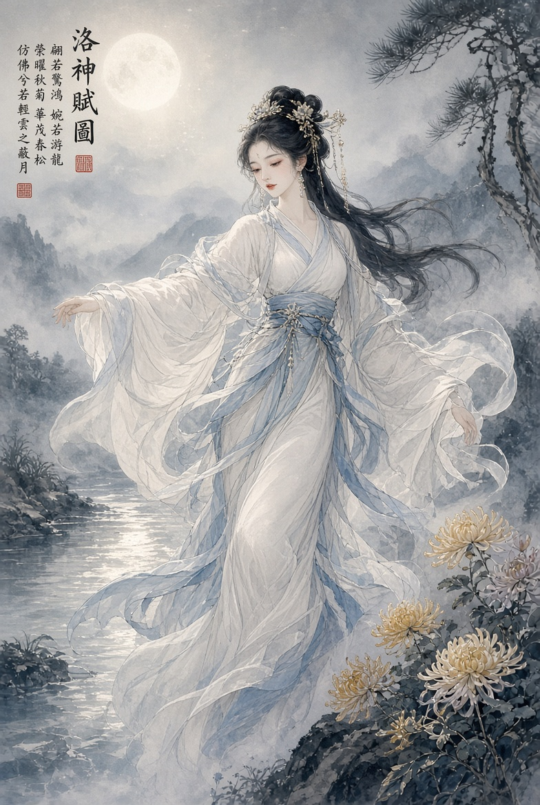

# 洛神賦

曹植

## 姿容（節選）

其形也，翩若驚鴻，婉若游龍。榮曜秋菊，華茂春松。

[中略]

遠而望之，皎若太陽升朝霞；迫而察之，灼若芙蕖出淥波。

襛纖得衷，脩短合度。肩若削成，腰如約素。延頸秀項，皓質呈露。

芳澤無加，鉛華弗御。雲髻峨峨，脩眉聯娟。丹脣外朗，皓齒內鮮。

明眸善睞，靨輔承權。瑰姿豔逸，儀靜體閑。

原文：[維基文庫《洛神賦》](https://zh.wikisource.org/zh-hant/洛神賦)。配圖由使用者提供。
